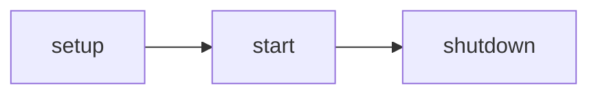

## Asides

<Aside>Default (note) aside.</Aside>
<Aside type="tip" title="Custom tip title">Tip with a **title** and `code`.</Aside>
<Aside type="caution">Caution aside.</Aside>
<Aside type="danger">Danger aside.</Aside>

## Badges

<Badge text="Default" /> <Badge text="Note" variant="note" /> <Badge text="Tip" variant="tip" /> <Badge text="Caution" variant="caution" /> <Badge text="Danger" variant="danger" /> <Badge text="Success" variant="success" />

## Tabs (with code and a nested aside)

<Tabs>
  <TabItem label="Java">
    ```java title="Hello.java" {2}
    public class Hello {
        void hi() { System.out.println("hi"); }
    }
    ```
  </TabItem>
  <TabItem label="JSON">
    ```json title="item.json"
    { "Id": "Sword", "MaxDurability": 200 }
    ```
    <Aside type="tip">Aside inside a tab.</Aside>
  </TabItem>
</Tabs>

## Steps (with a file tree inside)

<Steps>
1. First step, plain text.

2. Second step with code:
   ```bash
   ./gradlew build
   ```

3. Third step with a file tree:
   <FileTree>
   - src/
     - Main.java
   </FileTree>
</Steps>

## File tree

<FileTree>
- Assets/
  - Server/
    - Item/
      - **Weapon_Sword_Custom.json** the file you edit
      - Weapon_Sword_Iron.json
      - …
  - Common/ client-side assets
- manifest.json
- README.md
</FileTree>

## Cards

<CardGrid>
  <Card title="Card with icon" icon="star">Body text of a card.</Card>
  <Card title="Another card" icon="setting">Second card.</Card>
</CardGrid>

<CardGrid>
  <LinkCard title="Link card" description="Goes to Setup." href="/getting-started/setup/" />
  <LinkCard title="Another link card" href="/appendix/glossary/" />
</CardGrid>

## Code

```java title="MyPlugin.java" {3-5}
public class MyPlugin extends JavaPlugin {
    @Override
    protected void setup() {
        getLogger().info("hello");
    }
}
```

## Mermaid



## Image (click to zoom)


