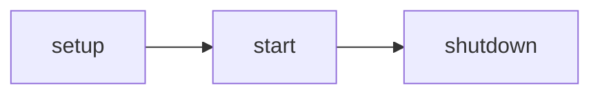

## Titled block with meta line highlight

```java title="MyPlugin.java" {2-3}
public class MyPlugin extends JavaPlugin {
    public MyPlugin(JavaPluginInit init) {
        super(init);
    }
}
```

## Mermaid


